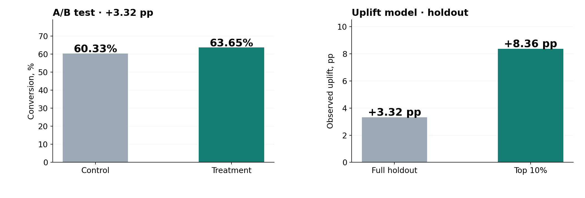

# RetailHero — A/B Testing & Uplift Modeling

Анализ эффективности рекламной коммуникации на данных X5 RetailHero: классический A/B-тест, исследование клиентских сегментов и uplift-модель для выбора аудитории.



## Результаты

- **200 039 клиентов** в A/B-эксперименте.
- **60,33% → 63,65%** — конверсия в контрольной и экспериментальной группах.
- **+3,32 п. п.** — средний эффект, 95% ДИ **[+2,90; +3,75] п. п.**
- **+8,36 п. п.** — наблюдаемый uplift у топ-10% клиентов по ML-модели на holdout (в среднем по holdout — **+3,32 п. п.**).

Для проверки гипотез использованы z-тест двух долей, SRM и доверительные интервалы. Различия по сегментам исследованы через тесты взаимодействий. Uplift оценивался с помощью **T-learner** на двух моделях градиентного бустинга (`HistGradientBoostingClassifier`); качество ранжирования проверено на отложенных 30% данных.

## Файлы

- [`notebooks/RetailHero_AB_Uplift.ipynb`](notebooks/RetailHero_AB_Uplift.ipynb) — весь анализ, графики и выводы.
- [`scripts/build_purchase_features.py`](scripts/build_purchase_features.py) — подготовка истории покупок по клиентам.
- `requirements.txt` — зависимости.

## Запуск

1. Открыть ноутбук в Google Colab и выполнить ячейки по порядку. Небольшие исходные таблицы загрузятся автоматически с Hugging Face.
2. Для сегментов по расходам и более полной uplift-модели положить `final_stats.csv` в рабочую папку Colab. Файл должен содержать `client_id`, `count`, `sum`.
3. При необходимости агрегаты можно получить из `purchases.csv.gz`:

   ```bash
   python scripts/build_purchase_features.py --input data/purchases.csv.gz --output data/final_stats.csv
   ```

Без `final_stats.csv` ноутбук тоже запускается, но модель использует только демографические признаки.

**Ограничения:** результаты uplift получены на отложенной выборке, а не в новой кампании. Экономический эффект рассылки не оценивался: в данных нет стоимости контакта и маржи.

**Датасет:** [ODS RetailHero](https://ods.ai/competitions/x5-retailhero-uplift-modeling/data) · [Hugging Face](https://huggingface.co/datasets/pytorch-lifestream/retailhero-uplift/tree/main/data). Исходные данные в репозиторий не включены.
